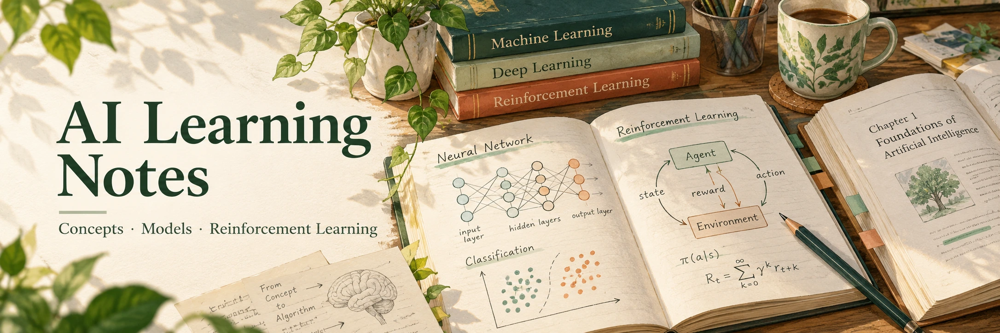
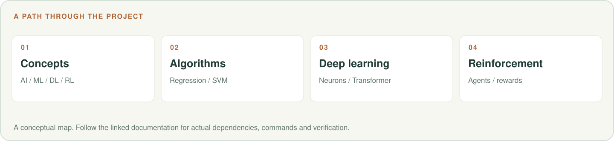

# AI Learning Notes

面向机器人方向初学者的中文 AI 入门笔记：先建立 AI、ML、DL、RL 的关系，再认识算法、深度学习与强化学习。

**[章节目录](#chapters) · [阅读建议](#reading) · [相关项目](#related)**

<picture>
  <source media="(max-width: 600px)" srcset=".github/readme/workflow-mobile.svg">
  
</picture>

## 章节目录

| 顺序 | 内容 |
|---|---|
| 00 | [总览 · 思维导图](00_%E6%80%BB%E8%A7%88_%E6%80%9D%E7%BB%B4%E5%AF%BC%E5%9B%BE.md) |
| 01 | [AI · ML · DL · RL的关系](01_AI_ML_DL_RL%E7%9A%84%E5%85%B3%E7%B3%BB.md) |
| 02 | [机器学习三大范式](02_%E6%9C%BA%E5%99%A8%E5%AD%A6%E4%B9%A0%E4%B8%89%E5%A4%A7%E8%8C%83%E5%BC%8F.md) |
| 03 | [经典监督学习算法](03_%E7%BB%8F%E5%85%B8%E7%9B%91%E7%9D%A3%E5%AD%A6%E4%B9%A0%E7%AE%97%E6%B3%95.md) |
| 04 | [深度学习核心](04_%E6%B7%B1%E5%BA%A6%E5%AD%A6%E4%B9%A0%E6%A0%B8%E5%BF%83.md) |
| 05 | [强化学习专题](05_%E5%BC%BA%E5%8C%96%E5%AD%A6%E4%B9%A0%E4%B8%93%E9%A2%98.md) |
| 06 | [术语速查表](06_%E6%9C%AF%E8%AF%AD%E9%80%9F%E6%9F%A5%E8%A1%A8.md) |

## 阅读建议

建议从总览与第 1 章开始；遇到陌生缩写时查术语表，再回到对应章节。

这是以 Markdown 为主的学习资料仓库，阅读本身无需安装依赖。章节中的示例可单独练习，
具体工具、软件版本和硬件条件应按对应章节核对。

## 相关项目

- [Python 基础与 RL 编程笔记](https://github.com/oye-Li-bc/python)
- [研究工作流 Skills](https://github.com/oye-Li-bc/research-workflow-skills)
- [个人作品集](https://oye-li-bc.github.io/)

封面由 imagegen 生成，路线图为可编辑 SVG；[图片说明](.github/readme/README.md)。
